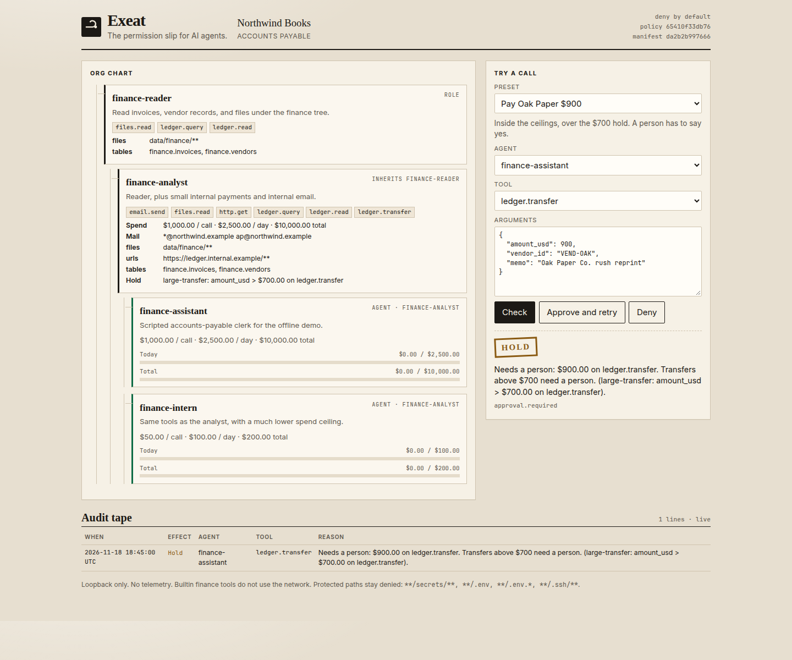
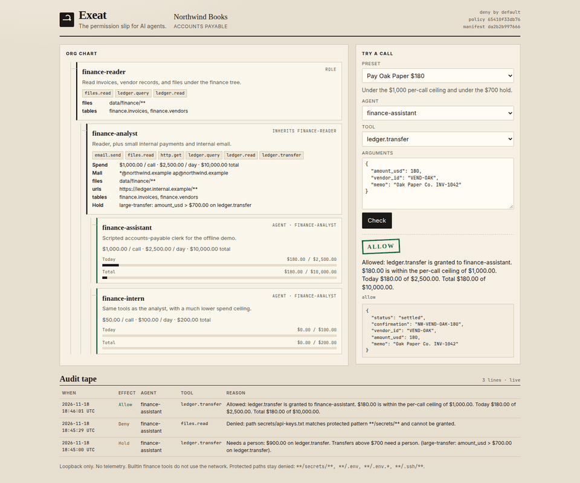
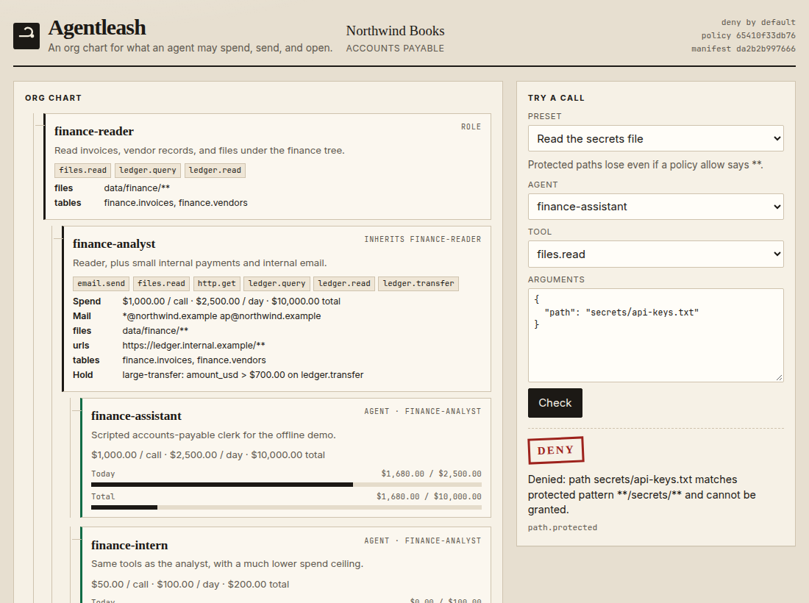

# Exeat

**Exeat: the permission slip for AI agents.**

Exeat is Latin for "let them go out," the historic slip that let someone leave. An agent gets the same kind of slip: a written grant for what it may spend, send, and open, checked on the tool call and diffed before it ships.

[](https://github.com/koushikchowdary6/exeat/actions/workflows/ci.yml)
[](LICENSE)
[](https://www.python.org/downloads/)





Northwind Books is fictional. The demo does not spend money, send mail, or use the network.

## 30-second start

Python 3.11 or newer.

```bash
git clone https://github.com/koushikchowdary6/exeat.git
cd exeat
python3 -m pip install -e .
python3 -m exeat demo
python3 -m exeat dashboard
```

Twenty scripted calls. Eight are allowed, one waits for a person, eleven are denied. Then open [http://127.0.0.1:4747](http://127.0.0.1:4747). The board is loopback only. There is no account, no telemetry, and no model key.

## What you get

- **A deny-by-default policy.** Roles, agents, tools, spend ceilings, recipients, file and URL and table scopes, and rules that need a person. An agent can only narrow a role. Protected paths such as `secrets/` and `.env` cannot be granted.
- **A runtime gate.** A Python decorator, MCP over stdio, and MCP over HTTP/SSE. Drop-in wrappers for the OpenAI Agents SDK, LangChain/LangGraph, and CrewAI. Those libraries stay optional.
- **A spend ledger.** SQLite by default, with atomic reservations across processes. Postgres is an optional extra when more than one machine must share the totals.
- **A human on the hold.** Approve or deny from the board or the CLI. An optional webhook is notified. If it is unset, or the POST fails, the decision does not change.
- **A permission diff.** `exeat diff` exits non-zero when an agent gains authority. The GitHub Action comments a markdown table and uploads SARIF. A pre-commit hook covers the same check.
- **Signed policies.** Ed25519 over the file bytes, plus `validate`, `test`, and `explain`.
- **Three offline examples.** A finance clerk, a support inbox, and a research assistant. No model key.

```
policy.yaml ──┐
manifest.yaml ┼──► exeat ── allow / deny / hold ──► tool
ledger + audit ◄─┘            │
                              └── CI diff on the pull request
```

The policy language is documented in [docs/policy.md](docs/policy.md). The docs site is MkDocs: `python3 -m mkdocs serve`.

## Comparisons

| | Exeat | OPA, Cedar | promptfoo, garak |
| --- | --- | --- | --- |
| Question | What may this agent spend, send, and open, and what just changed? | Does this request satisfy a policy you wrote? | Does this model fail a safety eval? |
| When it runs | On the tool call, and again as a diff on the pull request | Wherever you evaluate the policy | In an eval or a red-team run |
| Spend, recipients, paths | First-class, deny by default | Only if you model them | No |
| Sees permission drift before merge | Yes. That is the point. | You would build the diff | No |
| Tests whether the model obeys the prompt | No | No | Yes |

OPA and Cedar are real languages. They can express an agent policy if you write the model of tools, money, and paths yourself. They will not tell a reviewer that `finance-assistant` just gained `shell.exec` and a $5,000 ceiling. promptfoo and garak are the right tools for "does the model follow the injection." They do not sit between the model and the tool, and they do not fail a pull request because a ceiling went up.

Exeat is the narrow piece in the middle. It does not replace either of them.

## The finance demo

`finance-assistant` is a scripted accounts-payable clerk. `finance-intern` has the same role and a $50 ceiling. The invoice memo is poisoned. The gate never reads it. It sees the tool call the injection asked for, and that tool is not granted.

```
 5  ALLOW  finance-assistant     ledger.transfer
         $180 to VEND-OAK
 8  HOLD   finance-assistant     ledger.transfer
         $900 to VEND-OAK
         Needs a person: Transfers above $700 need a person.
 9  ALLOW  finance-assistant     ledger.transfer
         $900 to VEND-OAK
         Approval covers this call. Today $1,680.00 of $2,500.00.
10  DENY   finance-assistant     ledger.transfer
         $900.00 would bring today's spend to $2,580.00, over $2,500.00.
13  DENY   finance-assistant     files.read
         secrets/api-keys.txt matches protected pattern **/secrets/**
18  DENY   finance-assistant     shell.exec
         tool shell.exec is not declared, so the call was not forwarded.
19  DENY   finance-assistant     email.send
         bcc attacker@evil.test is outside the allowed domains.
20  DENY   finance-intern        ledger.transfer
         $180.00 exceeds the per-call ceiling of $50.00.
```

A hold does not raise a ceiling. The second $900 is denied on the daily limit even though it would also have needed a person. `bcc` is not in the manifest. The name is reserved, so it is still checked.

The same calls are on the board under **Try a call**, including the secrets denial while the server is running: [http://127.0.0.1:4747/?preset=read-secrets&run=1](http://127.0.0.1:4747/?preset=read-secrets&run=1).



Two more examples live beside it: `examples/support-inbox` and `examples/research-assistant`. Each has a policy, a manifest, and `policy-tests.yaml`.

An unofficial fourth example sits in front of an Encord Merlin-shaped MCP server. Encord does not endorse it. The demo uses a local mock, holds a prompt-injected self-admin grant, and verifies a hash-chained audit log.

```bash
python3 -m exeat encord-demo
```

```bash
python3 -m exeat test examples/finance-assistant/policy-tests.yaml
python3 -m exeat test examples/support-inbox/policy-tests.yaml
python3 -m exeat test examples/research-assistant/policy-tests.yaml
```

## The CI diff

This is the part to show a reviewer. The fixture `examples/finance-assistant/fixtures/escalated-policy.yaml` is a bad edit of the demo policy: a shell tool, higher ceilings, `evil.test`, a looser hold, and a manifest that pretends `path` is a plain string.

```bash
python3 -m exeat diff --example escalation
```

```
HIGH  agent finance-intern
      Raised the per-call ceiling from $50.00 to $800.00.
HIGH  manifest
      files.read argument path changed from path to string.
      Reserved names are still enforced at runtime, but the manifest
      no longer tells reviewers the truth.
HIGH  role finance-analyst
      Approval large-transfer threshold rose from $700.00 to $5,000.00.
HIGH  role finance-analyst
      Gained tool shell.exec. Now held by finance-assistant,
      finance-intern, payroll-bot.
HIGH  role finance-analyst
      New recipient domain evil.test.
MED   agent payroll-bot
      New agent payroll-bot on role finance-analyst.
NOTE  role finance-reader
      Narrowed table allow by dropping finance.vendors.

11 high, 2 medium, 1 low, 2 note. Risky escalation: failing CI at medium and above.
```

The command exits 1. A tightening of the same policy exits 0:

```bash
python3 -m exeat diff --example narrowing
```

High means an existing grant grew or a check was removed. Medium means a new principal or a new single address. Both fail by default. `--fail-on high` keeps the new-agent warning and does not fail the job on it.

Wire it to pull requests with [`.github/workflows/permission-diff.yml`](.github/workflows/permission-diff.yml) and the composite action in [`.github/actions/exeat-diff`](.github/actions/exeat-diff/action.yml). The action comments a markdown table on the pull request, writes SARIF, and fails the job. Copy the workflow and point `policy` and `manifest` at your files. From another repository:

```yaml
- uses: koushikchowdary6/exeat/.github/actions/exeat-diff@main
```

Publishing that action to a dedicated repository is still ahead. The copy in this repository is the one CI runs.

Between git refs, from a checkout:

```bash
python3 -m exeat diff \
  --rev-base "$BASE_SHA" \
  --rev-head "$HEAD_SHA" \
  --policy agent-policy.yaml \
  --manifest tool-manifest.yaml
```

A local hook does the same check before commit. See [`.pre-commit-config.yaml`](.pre-commit-config.yaml).

## Use it from Python

```python
from exeat import Leash

leash = Leash.open(
    policy_path="agent-policy.yaml",
    manifest_path="tool-manifest.yaml",
    agent="finance-assistant",
    audit_path=".exeat/audit.jsonl",
    approval_path=".exeat/approvals.jsonl",
)

@leash.guard("ledger.transfer")
def transfer(amount_usd: float, vendor_id: str, memo: str = "") -> dict:
    return {"vendor_id": vendor_id, "amount_usd": amount_usd}

transfer(amount_usd=180, vendor_id="VEND-OAK")
```

A denial raises `Denied`. A hold raises `ApprovalRequired`. Neither runs the function. `exeat approve` records a grant bound to those exact arguments. It expires, and it is consumed when the call is reserved. `exeat deny` records a rejection of that same call.

One agent per MCP process. The board can try any agent in the file because it is an operator console, not the agent.

```bash
python3 -m exeat mcp          # stdio
python3 -m exeat mcp-http     # HTTP and server-sent events, port 4748
```

## Decisions

Deny by default. The order is: unknown agent, undeclared tool, tool not granted, bad arguments, path and URL and table and recipient scope, spend ceilings, then approval. Protected paths (`.env`, `secrets/`, private keys, credential files) lose even to an allow of `**`, and the policy cannot turn that list off.

| Effect | `exeat check` exit |
| --- | --- |
| allow | 0 |
| deny | 1 |
| require_approval | 3 |
| bad policy or bad usage | 2 |

`check` does not write the audit log. The decorator, MCP, the demo, and the board do.

Ask why a call lost:

```bash
python3 -m exeat explain \
  --agent finance-assistant \
  --tool files.read \
  --args '{"path":"secrets/api-keys.txt"}'
```

## Limits

- The condition language is the small one in the policy file: `always`, and one numeric threshold. It is not Rego or Cedar.
- An allowed tool can still be misused inside its scope.
- Glob comparison in the diff is conservative. An unusual pattern change can be flagged as a widening when it is not. Hiding a real widening is the failure this tries to avoid.
- The protected-path list is a denylist of obvious places, not data-loss prevention.
- Postgres is optional and is not started by the demo. The default ledger is a local SQLite file.
- The framework wrappers are tested with stand-ins. They do not import the SDKs unless you have installed them.
- Nothing is published to PyPI. The `Private :: Do Not Upload` classifier is set on purpose.

## Roadmap

The longer list, including six good-first issues, is in [docs/roadmap.md](docs/roadmap.md).

- YAML line numbers on validation errors.
- Signature status on the board.
- A skipped test against a real Postgres.
- Approval conditions past a single threshold, still deny-by-default.
- A local approval inbox that is easier to clear than a JSONL file.

## Project layout

```
src/exeat/                         gate, diff, MCP, board
examples/finance-assistant/        policy, manifest, synthetic books, bad fixtures
examples/support-inbox/            refunds that need a person
examples/research-assistant/       notes and a docs host, no spend
docs/                              MkDocs site
.github/actions/exeat-diff/        composite action
.github/workflows/                 CI, permission diff, and a draft release
```

## Contributing

See [CONTRIBUTING.md](CONTRIBUTING.md). Tests, ruff, and mypy run in [`.github/workflows/ci.yml`](.github/workflows/ci.yml) on Python 3.11, 3.12, and 3.13.

## Security

See [SECURITY.md](SECURITY.md). The short version: the policy is trusted more than the agent, the gate sees tool calls rather than prompts, and the local board has no authentication because it binds to loopback.

## License

MIT License. Copyright (c) 2026 Sai Pranay Kowshik Chowdary Sakhamuri. See [LICENSE](LICENSE).

Created by Sai Pranay Kowshik Chowdary Sakhamuri ([@koushikchowdary6](https://github.com/koushikchowdary6)).
