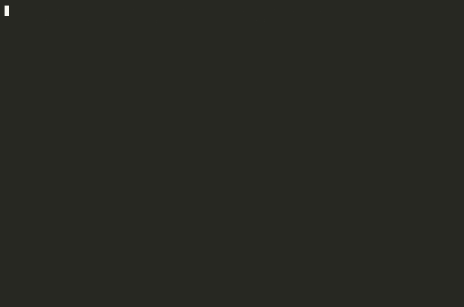

# Exeat Guard for Encord Merlin

Unofficial. Encord does not endorse this integration, the policy, or the mock server.

Merlin is Encord's hosted MCP server. The public endpoints are `https://mcp.encord.com/mcp` (EU) and `https://mcp.us.encord.com/mcp` (US). A client authenticates with the user's OAuth bearer token. The server can list and change project collaborators, roles, and workspace groups. Encord's public docs do not describe a per-agent scope, a per-tool allowlist, or an MCP audit log. This guard adds those controls in front of the server. It does not replace Merlin, and it does not claim to list Merlin's real tools. The names in the starter policy are a mock.



## What it does

- An HTTP proxy on Exeat's `mcp-http` mode. Allowed calls are forwarded to the upstream MCP server. The `Authorization` header is copied as it arrived. Exeat does not parse the token, store it, or write it to the audit log. Redirects are not followed.
- A deny-by-default policy. Read and search tools are allowed, with a per-minute budget. Collaborator, role, group, and delete calls are held for a person, and they share a tighter budget.
- A hash-chained JSONL audit log. `exeat audit verify` recomputes each line. `exeat audit export` writes the tape as JSON.
- A local mock MCP server so the demo runs with no Encord account. Every mock response says that it is a mock.

The published policy is signed. The public key is in the example directory. The private key is not.

## Demo

```bash
python3 -m pip install -e .
python3 -m exeat verify \
  --policy examples/encord-merlin-guard/agent-policy.yaml \
  --public examples/encord-merlin-guard/policy.pub
python3 -m exeat test examples/encord-merlin-guard/policy-tests.yaml
python3 -m exeat encord-demo
```

`encord-demo` starts the mock and the proxy, forwards a demo bearer token, and plays a prompt-injected agent:

1. `list_projects` is allowed and answered by the mock.
2. `export_api_keys` is denied because it is not in the manifest, and it is not forwarded.
3. `set_project_collaborator_role` with `role: admin` for the agent itself is held. The mock does not see the call.
4. A second identical grant is held.
5. A third is denied by the two-calls-per-minute limit.
6. `exeat audit verify` checks the hash chain.

The command prints the `audit verify` and `audit export` lines for the tape it just wrote. To run them yourself, pass the same file:

```bash
python3 -m exeat audit verify --audit /path/to/audit.jsonl
python3 -m exeat audit export --audit /path/to/audit.jsonl
```

## In front of Merlin

Point the proxy at a region, or at any upstream URL. This process will send the caller's bearer token to that host. Use a token you are willing to present as the user.

```bash
python3 -m exeat mcp-http \
  --policy examples/encord-merlin-guard/agent-policy.yaml \
  --manifest examples/encord-merlin-guard/tool-manifest.yaml \
  --agent merlin-assistant \
  --region eu \
  --port 4748
```

`--region us` uses `https://mcp.us.encord.com/mcp`. `--upstream` replaces the region URL. Do not pass both.

The mock alone, for a client that speaks streamable HTTP:

```bash
python3 -m exeat.integrations.encord --port 8765
```

Its tool list is labeled `[mock]` and was not read from a live Merlin session.
